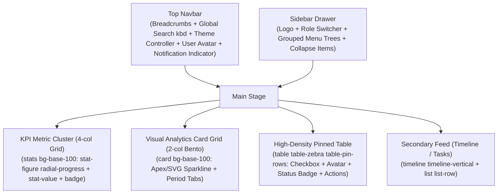

# daisyUI Store Templates — Architectural Blueprints & Deconstructions

Deconstruction of official templates from `daisyui.com/store/`, mapping UI composition, visual layout rules, and component integration patterns.

---

## 1. Nexus Dashboard 4.1 (Admin, Analytics, Operations)

### Archetype Essence
High-density, multi-layout operations center with persistent sidebar drawer, 4-tier metrics cluster, responsive data grids, and modular popovers.

### Structural Anatomy


### Key Component Composition
* **Shell**: `<div class="drawer lg:drawer-open">` containing `<div class="drawer-content">` and `<div class="drawer-side">`.
* **Top Bar**: `<div class="navbar bg-base-100/80 backdrop-blur border-b border-base-200">` equipped with search `<label class="input input-sm input-bordered flex items-center gap-2"><kbd class="kbd kbd-sm">⌘K</kbd></label>`, theme switcher `<select class="select select-sm select-ghost" data-choose-theme>`, and `<div class="indicator"><span class="indicator-item status status-info"></span><button class="btn btn-ghost btn-circle">...`
* **KPI Metrics**: `<div class="stats stats-vertical lg:stats-horizontal shadow-sm bg-base-100 border border-base-200/60 w-full">`
* **Data Table**: `<div class="overflow-x-auto"><table class="table table-zebra table-pin-rows"><thead>...` with status badges `<span class="badge badge-success badge-sm gap-1">Completed</span>`.

---

## 2. Scalo Startup Template 4.0 (SaaS Marketing & Conversion)

### Archetype Essence
Conversion-focused, highly visual startup landing page balancing crisp typography, social proof, bento feature grids, and interactive pricing.

### Section Blueprint
1. **Header Navigation**:
   * `<div class="navbar sticky top-0 z-50 bg-base-100/70 backdrop-blur border-b border-base-200/50">`
   * Centered `<ul class="menu menu-horizontal gap-1">`
   * Right CTA `<a class="btn btn-primary btn-sm rounded-full">Get Started</a>`
2. **Hero Stage**:
   * Headline with high-contrast font and dynamic subheadline.
   * Pill badge highlight: `<span class="badge badge-outline badge-primary gap-1 py-3 px-4 font-semibold">✨ v4.0 is live →</span>`
   * Dual action buttons: `<div class="flex gap-3"><button class="btn btn-primary btn-wide">Start Free Trial</button><button class="btn btn-ghost">Book Demo</button></div>`
   * Trust indicator: `<div class="avatar-group -space-x-4"><div class="avatar">...</div></div><div class="rating rating-sm">...</div>`
   * Frame preview: `<div class="mockup-browser border border-base-300 bg-base-200 shadow-2xl"><div class="mockup-browser-toolbar">...</div><div class="p-4 bg-base-100">...</div></div>`
3. **Logo Cloud**:
   * Grayscale partner icons with hover opacity transition (`opacity-50 hover:opacity-100 transition-opacity`).
4. **Bento Grid Features**:
   * Asymmetrical cards: 2-column or 3-column with `col-span-2` highlights.
   * Wrap interactive cards with `<div class="hover-3d">` or `card bg-base-200/50 border border-base-300/40`.
5. **Interactive Pricing Switcher**:
   * Billing toggle: `<div class="flex items-center justify-center gap-3"><span class="font-medium">Monthly</span><input type="checkbox" class="toggle toggle-primary" id="billingToggle" /><span class="font-medium">Annual <span class="badge badge-success badge-sm">-20%</span></span></div>`
   * 3-tier card deck: Starter, Professional (highlighted with `border-2 border-primary shadow-xl aura`), and Enterprise.
6. **FAQ Accordion**:
   * `<div class="join join-vertical w-full max-w-3xl"><div class="collapse collapse-plus join-item border border-base-300">...`
7. **Footer**:
   * `<footer class="footer p-12 bg-base-200 text-base-content">` with newsletter signup using `<div class="join"><input class="input join-item" /><button class="btn btn-primary join-item">Subscribe</button></div>`.

---

## 3. Online Store Template 2.0 (E-Commerce)

### Archetype Essence
Catalog browsing with faceted filtering, multi-image hover galleries, dynamic stock badges, slide-out cart drawer, and frictionless checkout.

### Key Layout Blocks
* **Top Promo Banner**: Seasonal countdown using `<div class="countdown font-mono text-lg"><span style="--value:48;"></span>h</div>`.
* **Product Catalog Grid**: 4-column responsive grid (`grid grid-cols-1 sm:grid-cols-2 lg:grid-cols-4 gap-6`).
* **Product Card Anatomy**:
  * Root: `<div class="card bg-base-100 shadow-sm border border-base-200 hover:shadow-lg transition-all group">`
  * Media: `<div class="hover-gallery aspect-square rounded-t-2xl overflow-hidden">` showing 2-4 angle previews.
  * Badges: `<span class="badge badge-error absolute top-3 right-3 font-bold">25% OFF</span>`
  * Pricing: Regular price + `<span class="line-through text-base-content/40 text-sm">$89.00</span>` + `<span class="text-xl font-extrabold text-primary">$69.00</span>`.
  * Actions: `<button class="btn btn-primary btn-sm w-full gap-2 mt-3">Add to Bag</button>`.
* **Faceted Filter Sidebar**:
  * Price range slider: `<input type="range" min="0" max="500" value="150" class="range range-primary range-xs" />`
  * Category chips: `<div class="filter gap-2"><input class="btn btn-sm" type="radio" name="frameworks" aria-label="All" checked="checked"/>...</div>`
* **Slide-out Cart Drawer**:
  * Embedded inside drawer sidebar with line item counters (`join` with `-`, count, `+`) and subtotal summary.

---

## 4. Auth Template 2.0 (Authentication & 2FA)

### Archetype Essence
Split-screen visual canvas pairing branded product imagery with frictionless authentication cards, social OAuth connect, and 6-digit OTP inputs.

### Key Layout Blocks
* **Split Container**: `<div class="min-h-screen grid grid-cols-1 lg:grid-cols-2">`
  * Left side: Branded visual hero with customer quote and ambient gradient mesh.
  * Right side: Centered `<div class="card bg-base-100 border border-base-200/80 shadow-xl max-w-md w-full p-8">`
* **Form Structure**:
  * Header: Brand logo + "Welcome back" title + subtitle.
  * Social connect: `<button class="btn btn-outline w-full gap-3">Continue with Google</button>`
  * Divider: `<div class="divider text-xs text-base-content/50 uppercase tracking-wider">or email</div>`
  * Grouped inputs: `<fieldset class="fieldset"><legend class="fieldset-legend">Work Email</legend><input type="email" class="input input-bordered w-full validator" required /><p class="label text-error text-xs">Valid email required</p></fieldset>`
* **Two-Factor OTP View**:
  * 6-digit digit input using DaisyUI OTP component:
    ```html
    <div class="flex justify-center gap-2 my-6">
      <input type="text" maxlength="1" class="input input-bordered input-lg w-12 text-center font-mono text-xl" />
      <input type="text" maxlength="1" class="input input-bordered input-lg w-12 text-center font-mono text-xl" />
      <input type="text" maxlength="1" class="input input-bordered input-lg w-12 text-center font-mono text-xl" />
      <input type="text" maxlength="1" class="input input-bordered input-lg w-12 text-center font-mono text-xl" />
      <input type="text" maxlength="1" class="input input-bordered input-lg w-12 text-center font-mono text-xl" />
      <input type="text" maxlength="1" class="input input-bordered input-lg w-12 text-center font-mono text-xl" />
    </div>
    ```

---

## 5. Documentation Template (Developer Docs & API Reference)

### Archetype Essence
Three-column desktop layout (Left navigation menu, Center markdown prose, Right on-this-page table of contents) with code mockups and parameter diffs.

### Key Layout Blocks
* **Top Header**: Navbar with version chip `<span class="badge badge-neutral font-mono text-xs">v5.7.0</span>` and global shortcut `<label class="input input-xs input-bordered"><kbd class="kbd kbd-xs">⌘K</kbd></label>`.
* **Sidebar Menu**: `<ul class="menu menu-sm gap-1 w-64 min-h-screen">` with `<li class="menu-title">Core Concepts</li>`.
* **Mockup Code Sandbox**:
  ```html
  <div class="mockup-code bg-neutral text-neutral-content shadow-lg my-6">
    <pre data-prefix="$"><code>npm i daisyui@latest</code></pre>
    <pre data-prefix=">" class="text-warning"><code>installing dependencies...</code></pre>
    <pre data-prefix="✓" class="text-success"><code>done in 420ms</code></pre>
  </div>
  ```
* **Side-by-Side Diff Component**:
  ```html
  <div class="diff aspect-16/9 rounded-2xl border border-base-300">
    <div class="diff-item-1"><div class="bg-primary text-primary-content grid place-content-center font-mono text-xl font-bold">DAISYUI 5 (MODERN)</div></div>
    <div class="diff-item-2"><div class="bg-base-300 text-base-content grid place-content-center font-mono text-xl font-bold">LEGACY RAW CSS</div></div>
    <div class="diff-resizer"></div>
  </div>
  ```

---

## 6. Mobile App Showcase & Landing

### Archetype Essence
Mobile-first presentation placing a realistic smartphone mockup (`mockup-phone`) at the center of the viewport, surrounded by feature callouts and app store download badges.

### Key Layout Blocks
* **Phone Frame**:
  ```html
  <div class="mockup-phone border-primary shadow-2xl">
    <div class="camera"></div>
    <div class="display">
      <div class="artboard artboard-demo phone-1 bg-base-100 flex flex-col justify-between p-4">
        <!-- In-app UI -->
        <div class="w-full flex justify-between items-center text-xs opacity-60"><span>9:41</span><span>5G 100%</span></div>
        <div class="my-auto text-center">...in-app feed...</div>
        <!-- Dock bottom bar -->
        <div class="dock dock-sm bg-base-200 rounded-xl">
          <button class="dock-active"><svg>...</svg></button>
          <button><svg>...</svg></button>
          <button><svg>...</svg></button>
        </div>
      </div>
    </div>
  </div>
  ```
